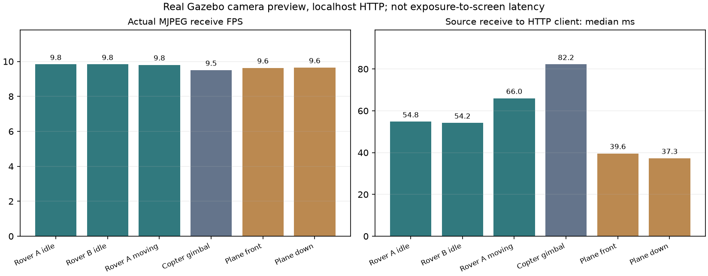

# Camera Web Preview V1

日期：2026-11-03。原始验收目录：`artifacts/camera-preview-20261103/`。
本功能只读图像，不取得 Operator 控制权，不开启 SEND，也不创建车辆命令端口。

## YOLO 画面扩展（2026-11-05）

后续增稳扩展为原始、增稳、YOLO（增稳）三个来源，检测与定位共同使用虚拟相机域；
当前实现与验收见[虚拟云台说明](VIRTUAL_NADIR_CAMERA.md)。本节以下保留首次 YOLO
画面接入时的两来源验收记录。

车辆控制页的“摄像头来源”改为“画面来源”。明确启动的 `copter_rescue` 实例提供
原始下视画面与“YOLO 识别画面”两个选项，普通车辆继续显示已有来源。新来源复用
同一 PT 工作进程、同一输入帧和该次检测结果，不增加推理进程。绿色框为 PT 的
类别/置信度，青色 `H marker` 框为独立的黄底 H 几何检测器。顶部计数仅统计 PT，
耗时覆盖本帧 PT 与 H 检测；面板的“相机 FPS”仍是原始采集速率。

`world/perception/vision/preview.py` 在副本上绘制并编码 JPEG，工作进程在发布原
感知结果之后原子发布 `preview.packet`。绘制失败不会丢弃已发布的感知结果。
`world/sensors/camera/processed.py` 只读该包，校验原相机、推理进程存活、模型
摘要、World generation 和固定 detector epoch，保留原相机 sequence、capture clock、
capture/receive 时间。原捕获年龄超过 1 秒不显示；新编码不会刷新旧帧的有效期。
即使像素目标不能投影为 WorldObject，也可显示本次真实像素检测框。

新来源沿用同一实例注册、认证、MJPEG、截图和退出机制，没有新增控制权限或 Writer。
适配器 close 仅退役视图，原相机和推理进程仍由原车辆 Owner 清理。

原生只读验收：`python -m tests.simulation.yolo_preview artifacts/new-yolo-preview`。
本机证据 `artifacts/yolo-preview-native-20261105-r2/result.json`：真实 CUADC 相机/PT、
连续新帧、真实 Chromium 登录及原始/YOLO 切换、截图、断流清屏/拒绝旧截图、恢复和
COMPLETE 清理均通过；双 SEND 关闭、无 Lease、Writer attempts 为 0。
地面图像在该轮为 0 个目标。真实 PT 对原数据集图片的正例框显示另见
`artifacts/yolo-positive-model-validation/`，不作为本轮飞行检测证据。
全量单元回归 1002 项通过（140.169 秒）；原控制台 JavaScript 行为检查与
画面脚本语法检查通过。新增 6 项单元检查覆盖同帧框绘制、输入不变、原时间保留、
过期与来源栅栏、工作进程/相机失效及只退役视图的清理边界。
下文 2026-11-03 的原始验收结论仍按当时范围保留。

## 审计结论

| 原有位置 | 实际能力与问题 | 本次处理 |
| --- | --- | --- |
| `world/sensors/camera/live.py` | 独立 OpenCV 采集进程、最新 JPEG、健康信息；支持 V4L2 和有限录像。图像和健康文件分开替换，可能错配 | 复用 CameraSource 与进程清理；一个原子 packet 配对 JPEG、序号和采集/接收时间；保留旧 `frame()` 接口 |
| `world/sensors/camera/recorded.py` | 已有有限录制图像的 YOLOX 推理管线，不是纯预览源 | 未接入预览，不启动推理；Recorded 预览走 CameraSource，明确标记录像且 EOS 不循环 |
| 旧 `/api/camera` 与硬件只读控制台 | Unix 应用接口返回 Base64 JSON；旧页面约 400 ms 轮询 | 保留兼容接口及 HardwareReadOnly 限制。统一 `/control` 使用认证 MJPEG；没有把硬件旧入口宣称成新统一实例装配 |
| 当前 `/control` | 原先没有车载视频面板；共用 BrowserSessions、Host/Origin、审计和有界 HTTP 工作者 | 增加独立只读面板，复用这些边界，无视频授权即车辆控制授权的隐式转换 |
| 固定 Rover | 只有 `base_link/imu_sensor`，没有摄像头 | 版本化前视光学传感器装配，无质量、碰撞或控制器变更 |
| 固定 Copter | `gimbal/pitch_link/camera`，640×480、10 Hz；有旧 UDP 视频插件 | 使用真实传感器；仅在运行副本禁用旧 GstCameraPlugin 视频输出，并记录改动 |
| 固定 Plane | `base_link/front_camera` 和 `down_camera`，1024×768、20 Hz | 复用真实传感器；预览缩放至 640×480、输出最高 10 FPS |

既有 `bind_model` 已为顶层绝对图像 Topic 加车辆前缀；不是所有旧图像 Topic 都未隔离。
新装配进一步统一 World/实体/传感器范围，并处理嵌套模型及 camera-info 来源，避免依赖隐式名字或固定 UDP 端口。
原始各车型传感器 XML、基线 fingerprint/model_hash/sensor_hash 保存在 `model-audit.json`。
历史相机/传感器软件夹具、P26 导航 FAIL 和控制阶段 ReturnHome FAIL 仍保留，不能由本预览验收覆盖。

## 所有权、装配和接口

`app/simulation/camera_assembly.py` 在 VehicleRegistry 完成原锁定校验、复制模型后工作，
只编辑该次自有运行目录。新增的 `simulation/sensors/rover-front-v1.sdf` 属于传感器装配，
不属于场景；R01、其他 World 和 Vehicle 定义继续独立。原车辆源文件、锁定清单、
参数、惯性、碰撞、关节、执行器映射没有改动。

每个实例的 `camera-assembly.json` 分别保存：装配 ID/version、原 base fingerprint、
装配前 prepared SHA、装配后 SHA、配方 SHA、各自有副本 SHA、原 Topic、新 Topic、
父 Link、模型 scope 和移除的视频插件。**base fingerprint 不是装配后模型的完整指纹**，
不能把二者混称为同一个传感器模型。`vehicle.json` 的 prepared_model_hash 更新为实际装配后 SDF，原值单列为 base_prepared_model_hash，避免指向已变化文件的旧 SHA。Gazebo World 启用既有 Sensors 系统与 Ogre2，
`--headless-rendering` 是原生传感器渲染，图像不是 Gazebo GUI 截图。

图像 Topic 为 `/vaf/camera/<World>/<entity>/<slot>/image`。
`camera_id` 是完整 `{target, vehicle_id, world, session, epoch}` 与 slot 的摘要；epoch
来自已验证物理仿真部署身份。删除/换 World 会失效，重建实例会产生新 ID。车辆 MAVLink
链接重连不把相机搬到另一车辆，摄像头数据健康独立于车辆运动控制授权。

- `world/sensors/camera/manager.py`：最多 16 个已绑定来源；目录、读取、退役和退出。
- `live.py`：复用 Gazebo、V4L2、Recorded 的显式独立进程生命周期。Gazebo 工作进程注册在原 VehicleSession；不在普通导入时启动。
- `gazebo.py`：只订阅 Image 和该 World 的 Clock；有界最新输入。Gazebo/RGB/OpenCV 依赖仅在采集工作进程中加载。
- `packet.py`：有界 JPEG 和元数据原子包；不是推理数据总线。
- `app/web/camera_http.py`：认证目录、MJPEG、截图和流审计。
- `static/camera-preview.*`：单独选择、实时状态、全屏、截图、旧帧清除；位于车辆控制页侧栏。

可信本机装配可以调用 `CameraSourceManager.add_source(binding, slot, config)`，config 的 kind
为 `gazebo`、`v4l2` 或 `recording`。设备路径/文件路径由可信部署提供，**Web 不接受任意
路径、Topic 或启动命令**。后续 CSI/GStreamer 适配器可实现 `health()/packet()/close()`
并通过 `register()` 接入；本版没有宣称这两个后端已经实现，也没有接入 YOLO、导航或自动驾驶。

HTTP 接口均要求现有登录 Cookie 或既有 API Bearer；URL 不能带认证凭据，target 必须显式给出：

```text
GET /api/cameras?target=<target>
GET /api/cameras/<camera_id>/stream?target=<target>
GET /api/cameras/<camera_id>/snapshot?target=<target>
```

目录返回 camera_id、slot、完整 binding，以及来源、原/预览分辨率、配置/实测 FPS、序号、
采集时钟/时间、主机接收时间、编码时间、年龄、在线状态和原因。MJPEG 每个 part 的 headers
记录 camera/target/epoch、sequence、capture clock/ns、source received ns、Web sent ns。
截图返回同样的身份和时间 headers。无新 POST 控制接口。

每次读取重新检查 target、部署 epoch、World/Session、退役状态；流在运行期间重复检查。
浏览器登录退出/过期即停止流；最多 4 条视频流，与原有 12 个 HTTP/4 个 WebSocket 预算区分，
预留原控制请求容量。每条流最长 60 秒，页面在 55 秒轮换连接。慢客户端写超时 0.5 秒，
请求设置 64 KiB socket 发送缓冲，不为每个客户端创建无限帧队列。OS 可能调整实际缓冲大小；
已经进入网络缓冲的帧不能撤回，过慢连接会关闭。HTTP 缓存关闭。

采集侧只保留一份待处理原始帧和一份最新 packet。JPEG ≤1 MB，packet ≤1,016,388 bytes；
输入尺寸/字节有上限。慢预览不能阻塞车辆 writer，也不阻塞后续推理消费者。

## 时间、过期与故障

Gazebo 采样时间是 Image header 的仿真时间，不能直接减去主机时间。
本机 Gazebo Clock 的 system stamp 用于拒绝排队超过 500 ms 的时钟消息；最新时钟对超过
750 ms 或图像落后仿真时钟超过 750 ms 时拒绝图像。100 ms 的允许领先只处理回调顺序。
重复/倒退图像时间锁定为相机故障，不带旧帧跨 epoch 恢复。

主机接收超过 1 秒或工作进程结束即不提供帧。页面每 500 ms 获取小型健康目录，主要视频
仍是 MJPEG，**不通过 Base64 JSON 传帧**。换车或换源先销毁旧 Image 节点，新节点收到并解码首帧才显示，避免复用旧解码图像。页面失去健康更新时按帧年龄清屏；失焦不改变
只读视频授权，页面隐藏暂停预览。控制按键失焦的原有停车逻辑保持原样。

V4L2/Recorded 的物理曝光/采样时间没有校准，保持 unknown；记录读取完成的主机接收时间。
录像明确标记来源，不循环 EOS，也不冒充实时仿真。相机断流与错误不成为车辆控制许可；
异常健康文件也只产生相机 FAULT，不让相机的 JSON 解析异常变成 World 故障。

UI 的“延迟（主机帧年龄）”不是未经校准的曝光到屏幕延迟。原生报告的 source-to-Web
表示采集进程收到图像到认证 HTTP 客户端收到完整 JPEG 的同主机单调时间差；Web transfer
表示 Web 发出到客户端接收。浏览器显示/解码延迟、跨机时钟同步没有被该数值认证。

退出仍先遵守原 Action 取消/物理停止与资源退出，再关闭车辆 Driver、相机工作进程、
实体和自有 Session；全局相机 Manager 完成最终清理。摄像头 close 失败不能压制原车辆清理。
没有修改 Mission、Action、Safety、MAVLink writer 或硬件控制权限实现。

## 验收记录

全量单元回归：**982 tests / 138.480 s / PASS**（`unit-final-source.log`）。新增 13 项覆盖 packet 原子配对/尺寸、时钟与过期、健康文件损坏、身份及来源上限、录像 EOS/进程清理、认证与 Host/Origin、目标错配、流期间注销/失效及视频预算。真实运动与像素验证不使用这些软件夹具代替。

| 实测来源 | HTTP FPS | Source→Web 中位 ms | P95 ms |
| --- | ---: | ---: | ---: |
| Rover A 静止 | 9.833 | 54.764 | 110.067 |
| Rover B 静止 | 9.832 | 54.183 | 101.646 |
| Rover A 前进/转向 | 9.806 | 65.973 | 112.274 |
| Copter 云台 | 9.503 | 82.194 | 111.000 |
| Plane 前视 | 9.635 | 39.589 | 61.677 |
| Plane 下视 | 9.649 | 37.257 | 63.337 |

这些为本机原生单次测试值，Web transfer 中位约 0.10–0.15 ms；不是跨机器网络或曝光到屏幕的保证。Rover 实际移动 1.174 m、两端 yaw 原始差值 -2.605 rad（未展开整圈，不作为转向符号性能结论），运动区间记录 196 个不同 JPEG，最终物理速度 0.0144 m/s，原 HOLD 退出安全释放。静止画面 JPEG 可以相同，但采样时间持续增长；独立 Gazebo 订阅逐帧核对了 JPEG 像素与采集时间，不能以“像素没变”判断为录像或静态替代。

双 Rover 8 秒采样：每只相机工作进程约 11.7–12.2% 单核 CPU、65.3–65.5 MiB RSS；Gazebo 约 108% 单核 CPU、751 MiB RSS；Web/验收主进程约 11.1%、64 MiB。实际 PIDs、tick 和两次 RSS 在报告中，不是估算。Web 数值包括本机验收客户端开销，RSS 求和会重复共享页，GPU 占用保持 unknown。

| 验收项 | 状态 | 证据/边界 |
| --- | --- | --- |
| R01 静止实时视频，未开启 SEND/Lease/控制权 | PASS | 两车 Writer 均为 0 |
| 受管 Drive 前进/转向时图像变化，原停车路径 | PASS | 独立 Gazebo 轨迹、运动帧与 Action ID |
| Rover A/B 图像隔离，错误 target 请求 | PASS | 唯一 topic/camera_id/epoch，错误目标 409 |
| 浏览器关闭重开、全屏、截图 | PASS | 真实 Chromium 与原生 JPEG |
| 摄像头断流、1 秒过期、恢复 | PASS | SIGSTOP/CONT 自有相机工作进程，页面清屏，失效截图拒绝 |
| 删除 B 后新增 C，旧请求拒绝 | PASS | 新 vehicle/target/camera_id/epoch |
| World 更换，旧帧/旧来源拒绝 | PASS | R01→新的 R01 World/Session，旧页面清屏 |
| Copter 与 Plane 原生已有相机 | PASS | 独立 Gazebo 像素/时间核对，双相机选择 |
| 慢客户端不积压应用帧队列，不拖慢正常流 | PASS | 2 秒一帧慢读，其他流约 9.8 FPS；有界 buffer/slot/超时 |
| 后端关闭后的相机/SITL/Gazebo 清理 | PASS | 所有原生会话 FINISHED / COMPLETE，相机 PID 消失 |
| 旧解码图像节点隔离、原控制界面回归 | PASS | 真实浏览器+明确标注的有限录像/Action 软件夹具；非运动验收 |
| Wheel 外部目录隔离安装与源码一致 | PASS | 配方和静态资源打包，未引入普通导入时的 Gazebo/视觉依赖 |
| 真实控制中心页面关闭及 systemd 清理 | PASS | 真实密码登录、原生相机、只读 Writer 0；页面关闭后 STOPPED、cgroup 空、OS 审计无残留/凭据错误 |
| 原六份 Mission、10 次跨车型执行 | PASS | Plane 3、Rover 3、Copter 4；全部 SUCCEEDED / release_safe，清理 COMPLETE |
| 未解决的本轮功能 FAIL | 无 | 历史失败逐项保留在下文 |
| 外部环境 BLOCKED | 无 | R01 拒绝 Plane 是正确准入，不放宽规则 |
| 实际 USB/CSI 采集、物理标定、CSI/GStreamer 后端、YOLO | NOT_TESTED / 未实现 | 发现 2 个 V4L2 节点但未打开；本阶段以 Gazebo 为主 |
| 飞机下视画面业务质量、GPU、长时间压力、强制 SIGKILL、跨机时钟/网络 | NOT_TESTED | F01 地面下视为均匀灰色，与原生像素一致；未改原模型外参换画面 |

[版本化验收摘要](evidence/camera-preview-20261103/acceptance.json)、[单元原始输出](evidence/camera-preview-20261103/unittest.txt)、[证据摘要](evidence/camera-preview-20261103/sha256.json)。完整 `web-frames.jsonl` 保存每帧身份、Gazebo capture ns、source received ns、Web sent/received ns、大小及 JPEG SHA，原始帧 JPEG 保留于各次 `frames/`；HTTP 日志、进程 manifest、camera-assembly 和资源采样同目录保存。认证头/密码/本机环境配置不提交。



[Rover 页面](evidence/camera-preview-20261103/preview-rover-A.png)、[双车 B 页面](evidence/camera-preview-20261103/preview-rover-B.png)、[过期清屏](evidence/camera-preview-20261103/camera-stale-cleared.png)、[Plane 前视](evidence/camera-preview-20261103/preview-front_camera.png)、[Plane 下视](evidence/camera-preview-20261103/preview-down_camera.png)。界面截图用于界面证明，真正的视频源与逐帧 JPEG 分开留存。

R01 原生验收包括独立 Gazebo 像素/采样时间核对，静止与运动时 MJPEG，真实浏览器登录、
来源选择、全屏、截图、关闭重开、断流/恢复、双实例隔离、删除/重建和更换 World。
运动仍由原有受管 Drive 经双 SEND、Lease、Safety 和唯一 Writer 完成；没有直接飞控写入。

保留的失败：`acceptance-1` 在真实视频与原生像素匹配通过后，测试脚本的非函数式
`wait_for_function` 触发页面禁止 unsafe-eval 的 CSP，未完成浏览器验收。修改为函数式
测试写法后复测，未放宽 CSP。`probe-1.log` 首次执行也记录过临时脚本无法导入 tests 的
调用问题；随后用正确项目运行入口完成探测。两者没有被改写成当次 PASS。首次 `--no-build-isolation` 的 wheel 构建因虚拟环境没有 setuptools 失败，改用项目标准隔离构建通过，失败日志仍保留。

另一次 `plane-final` 尝试沿用了测试夹具的 R01 场景，后端按原跑道准入规则拒绝，未创建车辆。该失败保留；固定翼相机改用已准入的 F01 跑道复测，没有放宽 World/车型兼容性。

## 使用与复现

正常 `./control-center` 启动并创建仿真后，进入“车辆控制”，明确选择车辆。
单摄像头自动预览；多摄像头需明确选择来源。查看视频不点击 SEND；只有原来的人工运动
操作才需要 SEND。截图保存在浏览器下载目录；“来源与实例”可展开查看完整绑定。
本地原生依赖来自统一 HostEnvironment 索引，未修改独立 ArduPilot 或 Gazebo 插件工程。

```bash
python -m pip install -e '.[mavlink]' -r requirements-vision.txt
python -m unittest discover -s tests -v
python -m tests.simulation.camera_preview --stage acceptance --run-dir artifacts/new-camera-rover --allow-send
python -m tests.simulation.camera_preview --stage copter --run-dir artifacts/new-camera-copter --allow-send
python -m tests.simulation.camera_preview --stage plane --run-dir artifacts/new-camera-plane --allow-send
python -m tests.simulation.camera_center_native --run-dir artifacts/new-camera-center
```

原生脚本的 `--allow-send` 只授权自有仿真中的运动验收；静止预览步骤仍断言 SEND、Lease
和命令 Writer 均未开启。每次使用新目录，保留原始结果。

控制中心专项使用新的私有 VAF_RUNTIME_ROOT 与临时测试密码，不重置现有操作员密码，不接管已运行的服务。实际页面关闭及 systemd 的原始记录在 `center-final/result.json`。最终双相机界面及像素复测在 `plane-ui-final/result.json`；早期试验不覆盖删除。
