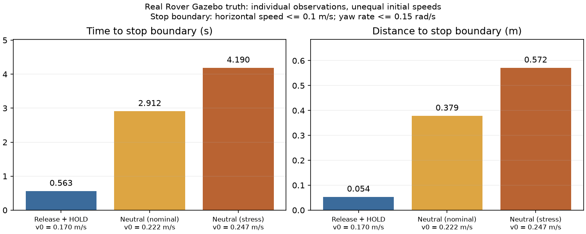
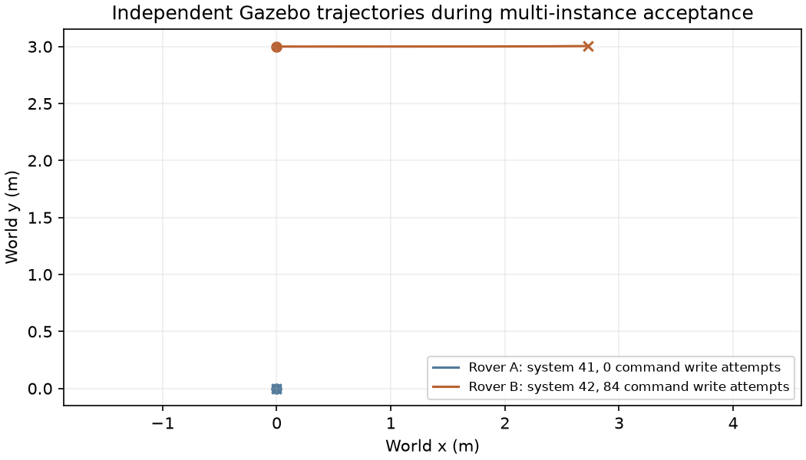

# Rover 连续驾驶与多实例 Mission 绑定修复

日期：2026-11-03。分支：`codex/control-center-lifecycle`。
本报告记录源码、单元测试、真实浏览器及原生 SITL/Gazebo 的验收结果。原始证据目录：
`artifacts/control-binding-20261103/`，其中早期失败记录保留。

## 根因与修复

| 问题 | 根因 | 修改 |
| --- | --- | --- |
| Rover 松键后需要重新 GUIDED | `manual-control.js` 的最后一个 keyup 调用 manual.stop；Drive 正常执行 StopMotion + HOLD 退出 | 独立“连续驾驶”开关，初始关闭。开启创建一个有界的受管 Drive，W/A/S/D 组合只更新该 Action；松键和“归零保持”发送零目标 |
| 零输入不能证明已经停车 | 原接口只有持续目标和 Action 退出，没有会话内零目标的观测保护 | RoverStream 检查原 0.1 m/s、0.15 rad/s 边界；连续采样 2 秒确认停稳；8 秒内不能确认连续停稳时，失败进入原 StopMotion + HOLD 退出。原退出 8 秒限制和 2 秒稳定判定保留 |
| 停稳提示一直显示观察中 | 初次页面实测发现，将零目标起点和最近安全观测混用，重复快照会重置稳定时间 | 分开零目标边界、最新采样和稳定区间；重复快照不重置稳定时间，也不冒充新的运动观测 |
| HOLD 结果可能遮蔽 StopMotion 结果 | Rover Stream 在 StopMotion 后追加 ModeEffect，原通用退出检查最后一个结果 | 分别要求 StopMotion 的原物理停止证据、HOLD COMPLETED 与实际 HOLD 状态。未确认仍失败/UNKNOWN，不放宽到模式 ACK |
| 高频更新后退出偶发取错结果 | Driver 故意只发布写入周期后的状态；退出时最后一个旧速度结果可能尚未发布，稍后到达会移动数组边界 | Action Runtime 仅在退出回调中，按已发出的 effect_id 对齐结果。尚无证据只标 REQUESTED；真实 UNKNOWN、StopMotion 完成与 HOLD 完成分别保留。正常写入周期发布约束不变 |
| 程序关闭先拆仿真 | MissionControl.close 原先先调用 SimulationManager.close，再取消任务/等待 Action | 关闭时封锁新控制，先取消 Mission/Action，在既有 14 秒关闭预算内等待原安全退出，然后回收仿真。进程已消失仍不等于物理停止 |
| 顶部选车与实际执行不一致 | Studio 的 vehicle 仅影响目录；run.start 直接使用 publication.compiled.target | 两个执行选择器同步同一明确实例；运行请求必须携带实例身份和发布摘要。确认框及运行记录显示实际对象 |
| 多实例复用与版本不可变冲突 | 同一 Mission ID/version 的 compiled target 被当作唯一发布内容；修改 target 会违反旧日志不可变约束 | 发布内容保留原验证快照。每次运行从其定义及固定依赖重新编译，另存 execution_binding 和派生执行快照，不覆盖旧发布版本 |
| 模板残留首辆车身份 | 固定 ID 模板第一次安装时保存了当时的 target；复制/导入继续继承 | 新模板与复制、导入、恢复、新版本草稿清空 target；移除实例绑定的外部输入并记录待替换项。旧发布版本保持原文 |
| 已移除车辆仍在目录 | Driver 为保留 Action 命令证据不删除，而 Studio 直接遍历整个 drivers | 保留历史 Driver，只过滤实时目录和准入；关闭/移除实例不能重新运行 |
| 目录静态、静默选第一辆 | 页面只在启动加载目录；vehicle() 回退 vehicles[0]，select 默认选首项 | 周期刷新目录；空选择占位。创建/删除、离线/重连、World/epoch/generation 变化后清除过期选择，需重新明确选择 |

Rover 连续会话仍沿用 20 Hz 输入上限、0.4 秒输入期限、一次性序号/期限票据、
最长 60 秒 Action、Lease、双 SEND、SafetyPolicy、会话/generation 围栏及唯一 Writer。
关闭开关、停车/HOLD、失焦、页面隐藏、断线、撤销和退出使用完整安全退出。
归零保持不释放资源，也不创建第二个 Drive。普通 Goto、ReturnHome 没有改用连续模式。

## 接口及文件归属

- `actions/rover/standard.py`：连续 Drive 的零速度观测保护、即时采用新输入，以及独立的 HOLD/StopMotion 退出证据。
- `app/web/static/manual-control.*`：开关、组合键、归零与完整退出的区别、页面时间上限。
- `app/bootstrap/mission_binding.py`：从一个一致的 Driver 状态切片读取实时实例身份；没有默认目标。
- `app/simulation/manager.py`：接入时记录 vehicle_id、System ID、World 和仿真 Session；退役保留历史证据。
- `app/mission_designer/studio_service.py`、`studio_library.py`：目录、模板解绑、发布摘要核对和按实例重新编译。
- `engine/mission/studio_graph.py`：明确验证实例或未绑定空 target 的定义检查。
- `engine/mission/graph_runtime.py`、`journal.py`：不可变发布版本与派生运行记录分离；运行期间的实例围栏。
- `engine/action/manager.py`：异步退出结果按已发请求身份对齐；缺失的结果绝不当作 ACK 或完成。
- `app/web/mission_control.py`：原资源/控制准入、关闭顺序和实例身份连续性检查。
- `vehicles/ardupilot/command_port.py`、`app/bootstrap/action_driver.py`：有界只读 Writer 尝试计数与历史，时钟维护单独排除；没有新增发送入口。

`GET /api/studio-b/catalog` 的每个车辆增加 `binding` 和 `binding_error`。
可运行的 binding 包含 target、kind、vehicle_id、system_id、world、simulation_session、
物理部署 epoch 摘要、link session_id 和 generation。退役实例不出现在实时目录。

`POST /api/studio-b/run/start` 请求形状：

```json
{
  "publication": "MissionId@1.0.0",
  "definition_hash": "目录中发布版本的摘要",
  "binding": {"说明": "完整复制操作员明确选择的 catalog.vehicles[].binding"},
  "allow_send": false,
  "debug": false
}
```

示意中的 binding 必须替换为实际完整对象。缺少绑定、摘要不符、旧 target/epoch/generation、
离线、退役或身份不一致均在 Action 创建前拒绝。任务按所选实例重新检查 Action 合同版本、
车型、能力、车型参数、所有固定 SubMission、Provider、声明资源和外部输入；随后仍通过
原 Mission Group、Action、Authority、Execution 和 Safety。旧的省略绑定请求不再接受。

运行中没有修改绑定的接口。记录保存原 publication/hash/instance；普通重连或换图不能
继续旧任务。唯一保留的例外是原固定翼受审计的、显式 native continuation：它在同一物理
部署内先建立只读新链接，再按原 Action 准入授予控制；记录各次链接变化，原绑定不改写。
这不允许页面换车，不会把旧权限带到新链接。

定义中的 target 是发布时的验证对象，不能作为运行授权。六份旧 JSON 和已有发布内容
继续可用，但运行需要新绑定；恢复或复制草稿需重新选择验证对象。坐标仍是绝对 odom，
绑定车辆不会自动平移航点，不能把别车出生位置当作空旷目标区域。

## 验收记录

仿真由本仓库 SimulationManager 启动的隔离 Gazebo World、独立 ArduPilot SITL、签名 ProcessVehicleDriver 构成。运动以独立 GazeboTruthOracle 观测，不以 ACK 代替轨迹或停止。所有最终会话均完成 FINISHED / cleanup COMPLETE。

| 项目 | 状态 | 证据 |
| --- | --- | --- |
| 全量 unittest | PASS | 969 tests，135.462 秒，`unit-full-final.log` |
| Rover 同一 Drive 前进/后退/左右组合、连续变化、松键零保持、同 Action 恢复、主动 HOLD、deadman | PASS | `rover-aligned-final/result.json`、`truth-writer.jsonl` |
| 真实 Chromium 的 W+A/W+D、松键确认、OFF、失焦 | PASS | `rover-browser-final/result.json`、截图 |
| SEND 撤销、HTTP+WebSocket 同时断开、重连不自动恢复 | PASS | 同上；车辆实际安全停止，重连不创建新 Drive |
| 运动中程序正常退出 | PASS | 先 CANCELLED / release_safe，再移除实体；最后独立实测速度 0.003574 m/s |
| Rover A+B，选 B，A 只读 Mission | PASS | `binding-final/result.json`；A System 41 写入 0，B System 42 写入 84 |
| Rover+Copter 不兼容拒绝 | PASS | 新 Action/车辆 Writer 均未产生 |
| Copter A+B 同一不可变发布分别执行 | PASS | 两车实际起飞超过 1.15 m、降落并上锁，原始执行绑定分别保存 |
| 删除 A 再新增 C，旧绑定不能指向 C | PASS | 旧请求拒绝，C Writer 0，模板副本未绑定 |
| World 切换拒绝旧 target；新 target 携带旧 epoch/link/generation 分别拒绝 | PASS | 独立拒绝请求，Writer 0 |
| 运行中更换绑定 | PASS | 无 rebind 操作，前端选择锁定，原绑定历史不变 |
| 两浏览器独立选车、资源占用拒绝 | PASS | A 只读与 B 运动并行；冲突请求无额外 Action/Writer |
| 实例新增/删除/换图后目录同步 | PASS | 实际浏览器选项检查；身份变化清除旧选择 |
| 原六份 Mission 定义与发布兼容 | PASS | Plane 3、Rover 3、Copter 4，共 10 次原生执行；只读运行写入增量 0 |
| 旧发布快照日志、多实例派生执行、固定 SubMission、能力/Provider/参数重验 | PASS | `tests/mission_studio/test_instance_binding.py` 12 项 |
| 退出异步结果错位与真实 UNKNOWN | PASS | `tests/action_system/test_exit_publication.py` 2 项，缺失仅 REQUESTED |
| Wheel 隔离安装与源文件一致性 | PASS | `wheel-final-check.json`，示例计数 3/4/3；不依赖 checkout/本地索引 |
| 原 Rover ReturnHome 特定轨迹到达 | FAIL | `rover-origin/result.json`，到达超时；安全退出已确认，未改原到达阈值 |
| 外部依赖/设备造成的阻塞 | BLOCKED：无 | 本轮所需本地工具可用 |
| 实车、硬件断链、强制 SIGKILL、任意地图/障碍场景、统计重复试验 | NOT_TESTED | 不能由本次自有仿真外推 |
| 持续超过 8 秒滑行的原生故障注入 | NOT_TESTED | 最终真实样本均在限时内停稳；超时转 HOLD 分支由合同测试覆盖，不冒充原生故障试验 |
| 原生 MAVLink 传输单独切断专项 | NOT_TESTED | 本轮原生切断的是页面 HTTP/WebSocket；车辆链路/会话失效由既有合同回归覆盖 |
| 真实车持续完整 60 秒到期专项 | NOT_TESTED | 本轮原生覆盖 0.4 秒 deadman；60 秒页面/合同回归有自动化覆盖 |

原六份定义分别为 StateSurvey、DisarmedBranch、Ground_Patrol、Air_HoverLand、Air_SurveyReturn、Runway_Inspection；前两份在三个车型分别执行。`examples-{plane,rover,copter}/examples-summary.json` 保存每个节点的实际位置和清理结果。固定翼原 native continuation 的接续回归亦在此次真实 Plane 任务中通过。

### 真实停车性能

下表时间/距离取松键或请求退出后首次进入原运动边界：水平速度 ≤0.1 m/s、角速度 ≤0.15 rad/s。连续模式还必须持续观测停稳 2 秒，8 秒不能确认则失败并走原 HOLD 安全退出；完整退出仍要求原 StopMotion 更严格的证据。没有改变固件参数、安全阈值或控制增益。

| 路径 | 请求前实际速度 m/s | 到边界秒 | 距离 m | 结果 |
| --- | ---: | ---: | ---: | --- |
| 原松键结束 + HOLD | 0.170 | 0.563 | 0.054 | CANCELLED，安全释放 |
| 新松键零目标，普通直行后 | 0.222 | 2.912 | 0.379 | RUNNING / GUIDED，已观测停稳，原 Action 可恢复 |
| 新松键零目标，多次转向/反向后 | 0.247 | 4.190 | 0.572 | RUNNING / GUIDED，已观测停稳 |
| 连续模式恢复后主动 OFF/HOLD | 0.107 | 0.357 | 0.027 | CANCELLED，安全释放 |
| 输入过期，deadman + HOLD | 0.169 | 0.985 | 0.126 | TIMED_OUT，安全释放 |

这是不同速度、不同 PID 历史的单次真实观测，**不是匹配初始条件的统计 A/B 比较**。零目标在当前模型中停车较慢，不能称为性能提升。输入在同一 Action 下一 tick 更新，但当前物理模型反向速度/偏航响应需要数秒；最终验收使用 6 秒观察区间，末段真实车体速度/角速度必须与新目标方向一致。快速输入变化不等于车辆瞬时反向。



### 目标与唯一 Writer

B 实际执行 `Binding_Rover_Patrol@1.0.0`，A 同时执行无 SEND 的 StateSurvey。B 出生在 y=3 m，路径显式位于自己的直线区域；独立轨迹表明 A 保持原位，B 实际驶向目标约 x=3 m。A 的现有命令 Writer 尝试计数为 0；B 为 84，每条 recent.run_id 均属于 B Mission 的 Action，target_system=42。只读审计记录的是现有端口的写入尝试，不冒充成功 ACK；它没有新的写入能力。原始 100 ms 采样记录保留全过程，末尾有界 recent 仅保留 64 条。



### 可复查证据与复现

版本化的 [验收摘要](evidence/control-binding-20261103/acceptance.json) 包含完整绑定、Action ID、Writer 对应、停车值、清理结果；[文件摘要](evidence/control-binding-20261103/sha256.json) 便于核对。原始 `requests.jsonl`、`truth-writer.jsonl`、HTTP 日志、SITL/Gazebo 输出、全部失败原件仍在 `artifacts/control-binding-20261103/`，未用最终报告覆盖。认证头、机器本地配置和运行私钥不提交。

- [Rover 零速度保持截图](evidence/control-binding-20261103/rover-zero-hold.png)
- [Rover HOLD 后会话结束截图](evidence/control-binding-20261103/rover-HOLD-ended.png)
- [B 实际目标确认截图](evidence/control-binding-20261103/mission-B-confirm.png)
- [B 实际运行结果截图](evidence/control-binding-20261103/mission-B-result.png)

新增回归在 `test_rover_continuous.py`（6 项）、`mission_studio/test_instance_binding.py`（12 项）、`action_system/test_exit_publication.py`（2 项），以及关闭顺序、Writer 实际边界的既有测试补充。测试 Driver 只用于合同/拒绝分支，未把它的 ACK 当成车辆运动验收。浏览器布局/Copter 连续控制脚本也通过，但其 fixture 结果与上述原生运动验收分别记录。

使用新目录复现，避免覆盖历史原件：

```bash
.venv/bin/python -m unittest discover -s tests -v
.venv/bin/python -m tests.simulation.control_binding_native --stage rover-motion --run-dir artifacts/new-rover-motion --allow-send
.venv/bin/python -m tests.simulation.control_binding_native --stage rover-ui --run-dir artifacts/new-rover-ui --allow-send
.venv/bin/python -m tests.simulation.control_binding_native --stage binding --run-dir artifacts/new-binding --allow-send
.venv/bin/python -m tests.simulation.mission_examples --kind plane --run-dir artifacts/new-plane-examples --allow-send
.venv/bin/python -m tests.simulation.mission_examples --kind rover --run-dir artifacts/new-rover-examples --allow-send
.venv/bin/python -m tests.simulation.mission_examples --kind copter --run-dir artifacts/new-copter-examples --allow-send
```

本地下载的软件仍由 ignored 的环境索引定位；测试没有修改独立 ArduPilot/Gazebo 工程。

## 保留的失败记录

- `binding-first`：真实浏览器暴露 option disabled=false 被当作 HTML 布尔属性的问题；修复为属性赋值并复测，未产生任务运动。
- `binding-second`：原点附近的示例被用于北侧出生的 B，B 朝 A 附近驶去，Goto 超时；原始坐标不是相对当前车的位移。未修改安全阈值。绑定验收显式配置 B 出生位置附近的直线路径，六份原示例另行回归。
- `rover-final`：物理停车测试通过，页面停稳提示未通过，原因是重复快照重置稳定区间；修改观测状态机后重新验收。
- `rover-first` 是首轮探索记录，归零前实际速度与基线不同，不将该轮数值用于匹配条件的性能结论。
- `rover-accepted`、`rover-direction-check`、`rover-motion-final`：逐步强化独立轨迹校验时保留的失败。只看更新受理或整段净角度都不足以判定转向；最终同时记录净位移、末段角速度和车体有符号速度，实际正反方向须经 Gazebo 观测。
- `rover-motion-acceptance`：初版把原来 2 秒停稳持续时间误作响应截止，导致过早 HOLD。最终代码从原 Basic Action 复用同一 8 秒截止及 2 秒稳定常量；不是增加原安全时限。
- `rover-contract-final`：压力驾驶后的退出出现 `stop_exit_unconfirmed`，独立 Driver 最终仍确认停车。经审查发现异步末尾结果与退出数组边界竞态；保留该次失败，不将晚到的完成覆盖为原 Action 成功。新增错位和真实 UNKNOWN 的回归。
- `rover-origin`：旧式松键/HOLD 基线后的 ReturnHome 目标超时，实际最终距原点约 0.94 米，未达到原阈值。它发生在本轮连续模式压力测试之前；ReturnHome 实现未更改。该到达失败单列，不把已确认安全退出冒充返航到达成功。
- 更早的制动/时序失败仍在 `docs/MISSION_EXAMPLES_REPORT.md` 及其原始证据中，本次未覆盖或删除。

未修改 ArduPilot、Gazebo 插件或其他外部工程；没有硬件控制授权。仿真通过不等于实车认证。
