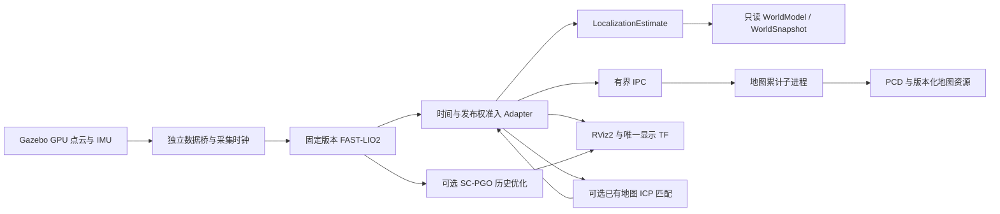

# MID-360 三维建图与只读定位

本功能只在本机 Gazebo / ArduPilot SITL 中使用。开发和实际验收结果见
[目标二验收报告](MID360_SLAM_GOAL2_ACCEPTANCE.md)；依赖准备、固定版本及许可证见
[依赖记录](MID360_SLAM_DEPENDENCIES.md)。编译成功或看到原始点云均不代表建图通过。

## 控制台操作

1. 从仓库的 `control-center` 启动原控制台，登录并进入仿真中心。
2. 选择 L01 几何检查场和普通 Rover（WildThumper 六轮车）或 Copter（多旋翼）。勾选
   MID-360，再勾选“启用逐切片时间的 LIO 输入”。默认配置不启动 SLAM。
   多车辆使用不同出生点；这两个选项仅供普通 Rover/Copter。
3. 创建并启动会话，打开 Gazebo 三维窗口，选中当前车辆，等待传感器在线。
4. 在“三维建图与只读定位”面板选择实时源，启动 SLAM，等定位在线后打开
   SLAM RViz2。面板不嵌入另一套点云地图。原 MID-360 RViz 仍用于原始数据检查。
5. Rover 使用原车辆控制/任务入口完成低速直行和转弯。Copter 使用原
   Arm、Takeoff、Goto、SetYaw、Land Action。仍须满足原系统和 Action SEND、
   SafetyPolicy；建图工具没有车辆命令端口，控制反馈仍来自 ArduPilot。
6. RViz 显示配准点云、滤波累计地图、示意车辆、TF 和有界轨迹，默认按高度
   着色。原始点云项可独立启用。局部原点有明确标签，不能当作 Gazebo 世界坐标。
7. 暂停/恢复只控制累计地图，FAST-LIO 继续估计。输入失效时只读定位撤销；
   需要新源或新时钟 epoch 时显式重新启动 SLAM，不能继续采用旧位姿。
8. 输入名称并保存地图；选择保存的 ID 后加载，再打开已保存地图视图。
   地图查看使用独立 Domain，加载显示不会恢复车辆定位。
9. RViz 可独立关闭和重开。停止仿真会关闭所属建图、回环、重定位、ROS 侧车、
   播放器和显示进程。关闭控制台仍沿用原进程组/systemd 归属清理。

另有 L02“围栏内闭环检查场”：保留 L01 外围几何，并在 (2,0) 增加半径
0.4 m、高 2 m 的真实碰撞立柱。原生验收经原 Drive 手动控制入口，以飞控报告
位置/航向执行预定义的两圈操作：名义中心 (1.5,0)、半径 1.5 m、速度 0.25 m/s。
独立真值裁判再检查实际绕柱圈数和间距；真值与 SLAM 均不进入操作反馈。
不改变原 ±5 m SafetyPolicy 围栏。它有独立
场景 ID 和地图来源，L01 的已有地图及几何保持原样。该预设路线是操作指令，
不是三维规划或自动避障；场景登记本身不代表实际验收通过。

SLAM 工具使用原认证 `/api/simulation/slam`，请求包含 `id`、`vehicle_id` 和
注册的 `action`；不会接收 shell 命令、PID、Domain 或任意文件路径。
`start` 的 `source` 明确为 `live` 或 `replay`；其他操作包括 `status`、`stop`、
`pause`、`resume`、`maps`、`save`（`name`）、`load`（`map_id`）、`rviz_start`、
`loaded_rviz_start`、`rviz_stop`、`pgo_start`、`relocalize` 和 `relocated_rviz_start`。

## 四项独立能力

连续 LIO 和局部累计地图使用同一套 Rover/Copter 实现。SC-PGO 是另行启动的
固定版本 Scan Context / ICP / GTSAM 历史位姿图优化器；只有状态报告实际应用
回环约束，才可声称检测到回环。未检测到回环时不能把普通里程计地图称为全局
一致地图。优化结果独立显示，不替换实时只读 LIO 位姿，更不进入车辆控制。
控制台保存按钮保存滤波后的局部 LIO 地图；PGO 历史优化地图独立显示，原生
验收另行导出测量，不覆盖地图目录中的局部地图。短路线检测到回环并发生优化，
不保证其漂移数值优于原始 LIO，实际对比见验收报告。

跨会话定位需要另一会话保存的兼容地图、当前合格 LIO，以及操作者提供的
粗略 `seed=[x,y,z,yaw]`（米、弧度，地图到当前局部坐标的初值）。它复用固定
FAST_LIO_LOCALIZATION2 的粗细 ICP 和质量门限，属于有初值的地图匹配，
没有承诺无初值的全局地点识别。成功后打开“已重定位视图”，显示保存地图、
匹配采集时刻的配准点云、示意车体和匹配轨迹。初值不合适、匹配过期或质量不足时不输出
有效位姿。切换另一保存地图须先重启 SLAM，避免同一 TF 子节点同时有两个父级。

## 数据、坐标和时序

`NS=/vaf/<独占实体>/sensors/mid360`，正式 SLAM 话题位于 `NS/slam`。
FAST-LIO 原始输出和原始算法 TF 使用独立名称。唯一 LIO Adapter 发布
`local_map → odom → base → lidar`，重定位有效时由它再发布
`saved_map → local_map`。局部 map→odom 为同一局部规约关系，不是
Gazebo world→base 的静态替代。所有动态变换使用原采集 stamp。
原始传感器查看的真值 TF 留在另一个话题，不被 LIO/地图匹配订阅。

Gazebo/ROS 使用 ENU/FLU；原 ArduPilot NED/FRD 转换保留原 Vehicle 责任。
WildThumper 模型原点与 base 重合（旧前驱/脚轮车的 0.19 m 偏移不适用）；雷达安装相对 base 为
Rover z=0.22 m、Copter z=0.16 m。内部 IMU 相对雷达为
(0.011, 0.02329, -0.04412) m。FAST-LIO 的状态原点为 IMU，Adapter 按这些
已知外参转换成车体原点。Gazebo 插件 IMU 的 g 显式转换成 m/s²，角速度 rad/s。

目标一均匀快照模式保持可选；它的逐点时间均为零，不用于本阶段去畸变验收。
目标二后端 `livox-gz-sliced-pattern-v1` 1.1.0 从每帧五张真实 Gazebo GPU 图像
采样记录的 Livox 方向模式，50 Hz 图像组成 10 Hz CustomMsg，点的时间是其
所属图像的实际采集时间。721×121 密集角栅格、40 m 单回波、2 cm 距离噪声、
0.15° 角噪声仍是近似，切片内运动不模拟；不是连续逐光线的真实 MID-360。
仿真 IMU 为 200 Hz；传输和算法订阅的 400 是缓存深度，并非采样频率。
没有器件温漂、雨雾、多回波、真实反射率量程或新增载荷动力学。

朝天空的切片可能没有返回点。`NS/scan_timing` 附带原渲染回调记录的五个
实际采集时间及每次返回数量（允许为零），不生成虚假点或补间时间。
Adapter 独立核对其与 CustomMsg、算法真正保留的逐点时间及实际接收的 IMU
时间一致，IMU 必须覆盖实际使用点和位姿采集时刻。`/clock`、QoS、发布者、
时钟 epoch、采集时间 TF、跳变和过期均有准入检查。

为避免重复生成大量 Python 点对象，侧车从打包 PointCloud2 中向量读取原
CustomMsg 保留的逐点 offset 与绝对采集时间，再与独立渲染事件核对实际返回
数量。可靠采集事件序列充当丢帧统计分母，显示观察器丢包不会缩小分母。

`LioWorldSource` 输出标准 `LocalizationEstimate`，经独立 `WorldModel` 提供
只读 `WorldSnapshot`；位置、姿态、源、版本和 Frame epoch 保留。速度明确为
相邻 LIO 位姿按仿真时间差分，协方差为空，质量为 DEGRADED，不虚报精度。
地图使用标准 `ResourceReference`；地图未变化时不刷新其采集时间和版本。
这个 World 不替换原 Driver World，不向 ArduPilot EKF 发送位置。

Gazebo 真值仅留在原始数据查看和独立测试裁判中。原 Action 控制链继续使用
飞控报告状态，图中的只读 World 不通向车辆命令端口。

## 资源和持久化

FAST-LIO 的表面/内部地图体素，Rover 为 0.30/0.50 m，Copter 为 0.15/0.20 m：
两者共用同一估计器，Copter 用单独配置保留更多姿态变化时的几何。
这些标准参数控制配准计算量；其密集配准
输出仍用于独立累计地图。`configs/mid360-map.json` 配置累计地图分辨率、候选点预算、范围和最少观察次数；启动时验证，运行后的修改不追溯已启动实例。累计地图默认 0.15 m 体素，每体素至少三次扫描观察，80 m 范围，最多 500000
候选体素；容量不足明确停止累计。显示轨迹最多 2000 点、按仿真时间 5 Hz
采样、最多 2 Hz 发布；定位和 TF 仍保留算法输出频率。导出队列和交换槽有界。
地图累计使用同一受管 LIO 进程组内的独立、无 ROS 子进程，两个 IPC 队列均
最多两项，避免地图增长时争用 ROS 准入线程的 Python 运行时间。地图子进程
失效撤销地图资源，定位位姿单独判断；定位工作进程失效时清理整个所属进程组。
FAST-LIO/SC-PGO 各 2 GiB、Adapter 1 GiB RSS 上限；PGO 最多 1000 关键帧，
达到预算后报错停 PGO，局部 LIO 状态单独报告。PGO 显示地图的标准体素参数为 0.15 m，
Scan Context/ICP 的原粗采样及门限未放宽。

已重定位视图只显示 `/relocated_registered`：唯一 Adapter 保留最多 20 份/32 MiB
已准入点云，在真实地图匹配完成后发送精确同采集时刻的原消息。它不把旧匹配
施加到更新扫描，不重写点云时间或给旧 TF 换新时间。历史局部地图与轨迹留在
局部视图，避免对早于匹配的采集时刻使用后来才获得的变换。

持久地图在 `RuntimePaths.state/maps3d`：二进制 XYZI PCD 和独立元数据，包含
内容校验、名称、车辆、外参、来源场景、会话、frame epoch、算法配置/依赖锁、
创建/保存时间和最后实际地图采集时间。最多 100 份，不自动删除用户地图。
加载检查格式、大小、有限坐标、版本、校验和、文件归属及符号链接。

逐切片录制比目标一增加 CustomMsg 和采集事件，共十类必要话题。先正常结束
录制，完成真实消息数量检查，再在回放源启动 SLAM。一次回放和循环回放沿用
原工具；循环回到起点产生时钟回退，旧 SLAM epoch 必须退出并显式重启。
实时、回放、静态地图 Domain 分开；恢复录制索引不接管旧进程或旧控制授权。
