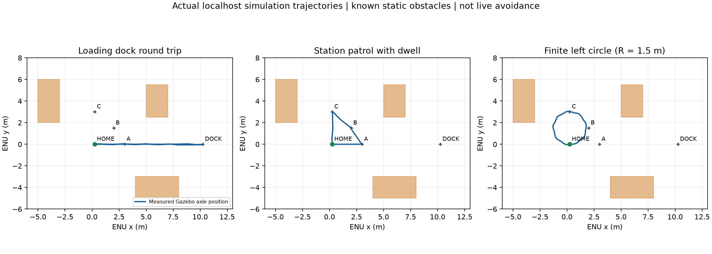

# LLM 参数化实用场景验收（2026-10-21）

本轮功能回归 **PASS**；Gazebo 原生启动可靠性仍 **FAIL**，P26
统一 Nav2 验收仍 **FAIL**。真实车辆运动及本场景实时避障 **BLOCKED**。
运行源码 `1feb0c930b39539d1f6d6eba8fd99e41b9410e28`，干净工作树，340 项单元测试、
0 失败/错误/跳过。文档提交可以晚于运行版本，不能据此替换运行源码。

## 新能力及保持的边界

独立 yard 配置提供30×30米封闭场地、装卸点、巡检站点、停放车辆/货架和
受限装卸区，Gazebo 含实际碰撞体。默认训练围栏未改。服务器真实模型生成
有界、带参数的注册能力组合；Application 将全计划绑定到审批时的前轴参考点、
场景、会话及源epoch，进行完整车体碰撞预检，随后走原 Mission→Action→
Typed Effect→Safety/双SEND/Lease→唯一writer。Core、基础contracts及legacy
相对本轮起点 `6f78c3c` 无变更。未连接或驱动真实车辆。

支持定距前进、定角旋转、有限绕圆、停车等待与命名点访问。每步完成均停车、
Disarm、释放权限，并观察新鲜静止遥测；后续步骤不会重新锚定当前位置。
“一直转圈”需要补充圈数、半径、方向。最多8步/600秒，速度0.08–0.18m/s。
150毫米越轨及500毫秒状态门槛保持；对齐仅允许受限的±0.05m/s位置修正。
其他车型不继承此车模的前轴运动资格。

## 冻结版统一回归

| 场景 | 结果 | 独立真值最大路径偏差/m |
| --- | --- | --- |
| 模糊/危险/越界/已知障碍拒绝 | PASS | — |
| 前进、左右90°与HOME返回 | PASS | 0.0456 |
| DOCK约10米往返、停留2秒 | PASS | 0.0577 |
| A→B停留→C→HOME | PASS | 0.0489 |
| 半径1.5米左转完整一圈 | PASS | 0.0624 |
| 原地左转720° | PASS | 0.0683 |
| 真实移动后离线Adapter故障与取消 | PASS | 0.0000 |
| 实际App只读重启与旧提案拒绝 | PASS | — |

所有8项均为独立创建的 localhost Gazebo/SITL、真实远程模型及认证Web/Application
链路。每项保存版本、模型提案、任务ID、ACK/状态、原始真值、受控关闭和端口
释放；重复批准被拒绝或返回原request-ID结果。独立审计不导入控制器，直接读取
world.sdf碰撞盒与被动Gazebo真值，另检路径、车体净空、站点停留速度与无运动。
本轮运动案例以0.15m/s运行，不是整个参数范围或所有组合的性能验收。
精确数值、源码/日志SHA见[便携证据](evidence/llm-practical-scenarios.json)。

取消场景在实际移动超过0.5米后调用一个明确不可用的LLM Adapter，观察原任务ID
保持，再发Web取消。不是关闭生产服务器/切断整车网络的验收。safe_recovery
只经注册Stop/Disarm链执行，不继续后续步骤；停车证据只属于仿真。
重启场景实际关闭App并以无SEND重启，旧参数化提案被新会话拒绝，真值无运动。

以下图形来自原始被动真值，显示已知静态场景中的实际路径。



## 修复与保留的失败

开发原始失败没有覆盖或删除：

- 早期前进停止容差与转向时前轴漂移触发越轨；收紧到达、限制中心修正后，
  下一轮独立验收又发现HOME最终航向未合格，随后增加显式航向收敛。
- 第一轮统一矩阵 `yard-suite-20261021-r1` 为5/7 PASS；长距离返回与巡逻FAIL。
  初始转向现使用完成确认的Stop边界和新stream。单独长距离返回仍曾失败，
  进一步改为沿批准直线的0.5米前视点，增加长走廊反馈方向单元回归。
- 第二轮统一矩阵 `yard-suite-20261021-r2` 为7/8 PASS；最后Gazebo在任务前
  native `transport discovery → getenv` SIGSEGV（-11），还未收到遥测。
  不是业务重启逻辑失败，也不能忽略。单项真实只读重启复测PASS；本轮结果
  见上表。崩溃根因尚未确认，不能声称已修复启动可靠性，没有静默自动重试。
- 原P26 Nav2跟踪/定位新鲜度失败仍未修复，本场景独立控制器不替换P26原门槛。

所有历史目录摘要与SHA均保留在便携证据，完整日志在
`artifacts/simulation/` 相应目录。统一回归本轮目录为
`artifacts/simulation/yard-suite-20261021-r3/`，含冻结源码tar及资源采样。
本轮功能PASS不抹去历史FAIL或未知崩溃原因。

## 资源、Web与范围限制

采样按已知PID及启动tick核对身份，未扫描无关进程。每个自有进程日志25MiB
上限由运行器持续检查。实际峰值见JSON；应用峰值RSS
34.66MiB，FD
7。这是每场景资源采样与清理验证，
不是通宵持续运行、无泄漏或本轮CPU门槛验收。

11项Node语法/合成DOM检查通过，含参数步骤、示例只填入、人工确认、CSRF、
预检失败禁止批准及token清空。浏览器不可用，未做浏览器可视验收。
旧Schema1两个真实模型兼容用例独立通过，保留各自版本，不与本轮物理版本混用。

此场景只有已知静态几何预检，**没有当前场景live LiDAR/Nav2动态避障或自动绕路**。
到站等待不等于视觉检测。不能在GUI任意更改障碍后继续继承静态场景资格。
摄像头业务、真实传感器外参、实车导航定位/制动/物理急停仍须另行验收。

## 演示与复现

见[操作与接口说明](../LLM_TASK_DESIGN.md)。已有私有模型转发时：

```bash
./scripts/simulation_console.sh --scenario yard --gui --allow-send \
  --llm-config config/llm.server-tunnel.json --lifetime-s 1800
./scripts/test_practical_scenarios.sh artifacts/simulation/yard-suite-NEW
python -m tests.simulation.practical_evidence --run-dir artifacts/simulation/yard-suite-NEW
```

页面 `http://127.0.0.1:8766`，使用启动输出指定的私有token文件认证。
填入任务→设计→检查步骤/参数/预检→人工确认→批准；不会自动执行示例。
Ctrl+C、受管GUI退出或期限到达均受控关闭自有栈。没有自动push或硬件部署。
