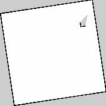

# P18：本机 ROS 2 Mapping 接入与验收

日期：2026-10-19。范围：本机 Ubuntu 24.04 amd64、ArduPilot Rover SITL + Gazebo Sim 8.15.0、ROS 2 Jazzy、SLAM Toolbox 2.8.5。真实车辆继续暂缓。

## 状态与完成口径

**PASS（限定场景与接入链）**：退出处理修正后的完整场景、最终 190 项单元测试和不加载 ROS 的 Copter 原路线兼容回归均通过。此阶段只验收**明确的 Rover 二维仿真场景**。轴对齐地图边界缺失仍未解决，不能据此声称通用 Mapping 或整个自主系统完成。

详细安装、演示命令、Frame/时钟及已知限制见 [运行说明](../ros2_mapping.md)。

## 实际交付

| 部分 | 实现与边界 |
| --- | --- |
| 可选 ROS 运行环境 | 系统 Jazzy 或签名校验的用户目录包提取；不修改系统安装，不要求根框架依赖 ROS。 |
| 仿真激光与时钟 | 实际 Gazebo GPU LiDAR，720 线、360°、10 Hz；ros_gz_bridge 只桥接激光和本轮世界时钟。 |
| ROS sidecar | 只读 App status，发布原采集时间的遥测 odometry TF，有限等待扫描配对；接收真实 SLAM 地图。没有车辆命令订阅、cmd_vel 或 MAVLink 写入。 |
| 地图资源 | 不可变 OccupancyGrid、SHA256 内容寻址、有限尺寸、原子元数据、PGM/YAML 导出。 |
| World Model | 不修改冻结合同；发布既有 WorldSnapshot.map、Map 依赖与新鲜度。旧图、异域、未来时间、过期、重启 source/frame epoch 冲突均拒绝采用。 |
| 正式运动链 | 原公开 CLI → Application → basic_route → Action → Effect → Execution/双 SEND/Lease/Safety → 原唯一 writer；没有新增导航控制入口。 |
| 故障隔离 | SLAM/sidecar 失效后撤下地图；原 App 仍可取消、物理停车、显式恢复上锁及关闭。地图失效本身不假装执行车辆命令。 |
| 保存与重载 | 真实 SLAM Toolbox serialize_map/deserialize_map pose graph；新发布者使用新 source epoch，禁止旧版本重放。 |

SLAM 的 map→odom 与 base_link_in_map 只作地图诊断，**没有替代 P10 遥测定位进入运动闭环**。现有路线也不使用地图规划或避障。

## 最终回归

已提交的精简 [证据快照](evidence/phase-18.json) 包含完整 summary、运行 manifest、依赖版本、场景/地图/pose graph 哈希。详细日志保留在本机 artifacts（不纳入 Git）。

| 检查 | 结果 |
| --- | --- |
| 全量 Python 测试 | **190 passed，0 failed/error/skipped**，11.652 s；其中新增 Mapping/时钟测试 13 项。 |
| Rover 实际建图与原 Mission | **PASS**；A/B/HOME 真值误差 0.185/0.347/0.129 m，原门槛 0.75 m；各到达与 Stop 速度均 ≤0.10 m/s。 |
| 最终栅格 | **178×178，0.05 m**；已知 24739 格、占据 966 格，四墙邻域检查全部通过。 |
| 导出与重载 | 内容 JSON 往返一致、PGM/YAML 与实际 pose graph 保存通过；重载后新 source epoch，四墙检查通过。 |
| 运动中 ROS sidecar 中断 | 地图撤下，公开取消 **3.002 s** 达到原物理停车稳定判据（期限 8 s，速度 ≤0.10 m/s 持续 2 s）；双 SEND 撤销，safe_recovery 确认 Disarm。 |
| ROS 正常关闭 | sidecar 退出码 0；App shutdown 成功，socket 消失，所有自有进程和端口清理通过。 |
| 不加载 ROS 的 Copter 兼容 | 原 basic_route **1/1 PASS**，原物理阈值和执行链不变，自有进程/端口清理通过。 |
| 默认入口与依赖边界 | status 仍 disconnected/SEND=false；contracts/core/mapping/world_model/actions/application 无 ROS 或 legacy 导入。 |

- Mapping 原报告：[summary](../../artifacts/simulation/ros2-mapping-30501ec0/summary.json)、[manifest](../../artifacts/simulation/ros2-mapping-30501ec0/manifest.json)。命令：`VAF_SIMULATION_SITL_BIN_DIR="$PWD/artifacts/simulation/suite-e8ba09fa/build/ardupilot/sitl/bin" python -m tests.simulation.ros2_mapping --allow-send`。
- Copter 原报告：[summary](../../artifacts/simulation/autonomy-copter-7523f8ef/summary.json)、[manifest](../../artifacts/simulation/autonomy-copter-7523f8ef/manifest.json)。命令：同一 SITL bin 环境下 `python -m tests.simulation.autonomy_process --kind copter --mission basic_route --allow-send`。
- 全量命令：`python -m unittest discover -s tests -q`。另验证 FIFO 文件拒绝、非法深层 JSON 拒绝和默认入口断开。

Mapping manifest 记录启动时源码摘要；该场景后只为地图输入增加非阻塞文件打开（拒绝 FIFO）及深层 JSON RecursionError 拒绝，相关 Mapping 测试和最终 190 项全量回归均在这些防御改动后通过。Copter manifest 记录包含这些改动的源码摘要；没有把较早场景的摘要冒记为最终代码摘要。

历史验证范围不冒记为重跑。已有 29 阶段/21 场景的 P9–P17 基线见 [既有审计](completion-audit.md)，本轮不宣称重新执行该整套套件。

## 失败记录与限制

失败报告保留在原 artifacts 目录，未覆盖为 PASS。额外 Copter 首轮 `autonomy-copter-e6295b45` 与另一仿真并发启动时，在未开始任务的启动期报 physical oracle stale；未修改阈值，单独重跑 `autonomy-copter-7523f8ef` 通过。Mapping 调试记录如下：

- `ros2-mapping-407a9881`、`ros2-mapping-a1990e08`：本机混合显卡 EGL 驱动路径不可用；最终采用有 DISPLAY 的 server-only GLX，不弹出 Gazebo GUI。无显示服务器的 EGL 运行没有通过验收。
- `ros2-mapping-cd5de2fa`、`ros2-mapping-71817ee6`：Jazzy MessageInfo 接口与预期不同；改为要求唯一地图发布者并读取 graph endpoint GID。
- `ros2-mapping-d63d9572`、`ros2-mapping-b9286de3`：跨时钟/TF 流乱序时直接丢弃扫描导致无地图；改为 16 条/750 ms 的有界等待，保留原时间，仍禁止外推。
- `ros2-mapping-6bc60b3f`：初始地图占据点稀疏，未达原几何检查；改用 720 线、0.05 m 栅格及显式 SLAM 参数，几何邻域与原运动/停车验收门槛未放宽。
- `ros2-mapping-6d53f0e1`：地图几何通过，但 ros2-run 包装进程清理检查失败；长期 ROS 程序改为 exec 实际可执行文件，CLI 禁止创建 daemon。
- `ros2-mapping-8a33cd33`：测试 Oracle 使用未绑定会话的 Environment；修复测试侧绑定，未修改车辆行为。
- `ros2-mapping-e881b2ed`：路线全部通过、pose graph 保存通过，重载服务超时；修复为 configure→activate→deserialize，服务在 active 生命周期才存在。
- `ros2-mapping-6f3d5b6a`：零旋转封闭房间移动后东/北墙部分占据点缺失，几何验收失败。与 [SLAM Toolbox #689](https://github.com/SteveMacenski/slam_toolbox/issues/689) 描述一致；**当前未解决**。最终场景将房间旋转 0.15 rad，四墙检查不变。该场景规避不能代替缺陷修复，也不构成任意几何可靠性证明。
- `ros2-mapping-d5e049e4`：旋转房间路线、四墙、导出、pose graph 重载、运动中 ROS 失效后取消停车均通过；随后修正 sidecar SIGTERM 的 rclpy context 退出竞争，并增加正常退出码检查，最终另跑完整场景。

本轮不包含：真实 LiDAR/相机与标定、硬件时钟同步、Copter/三维建图、地图参与 Safety/路径规划、Nav2、长期地图清理、任意 ROS 网络生产部署、轴对齐边界缺陷修复。Transport loss 时真实车辆物理停车仍未验收。

## 后续工作

1. 单独复现并修复 SLAM Toolbox 边界栅格问题，再恢复零旋转场景，补充多几何/多轮地图质量验收。
2. 若后续需要地图导航，先定义 map 查询与规划输出，再明确 map/odom 目标转换和回环期间行为；Planner/ROS 仍不得直接操作车辆端口。
3. 真实设备接入另立外参、时间源、传感器质量和整车停止验收；本轮不增加生产 profile。
