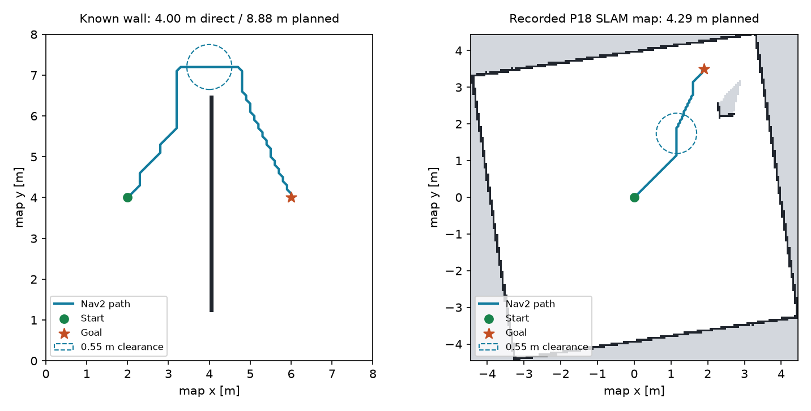

# P19 第一步：只读 Nav2 路径规划验收

日期：2026-10-19。状态：**PASS（只读二维规划范围）**。范围为本机 ROS 2 Jazzy / Nav2 SmacPlanner2D 的二维几何规划，复用 P18 的不可变地图和 Application 只读状态边界。

## 已实现

- ROS 无关的 MapContext、PlanRequest、PathCandidate、VerifiedPath；保留源地图内容/版本、Frame epoch 和采集时间。
- ReadOnlyPlanningService：输入预检、固定地图规划、身份/端点/整段碰撞检查、截止和返回前地图复核。
- Nav2 独立进程/namespace/地图/TF，实际 native Planner Server 生命周期、Costmap 一致性检查及所属进程组清理。
- `python -m app.plan`：显式记录地图或只读在线地图，输出 `executable=false`；未创建 VehicleRuntime、Mission、Action、Effect 或车辆连接。
- P18 记录地图数值 fixture 与可重复运行的绕墙、拒绝、原点旋转、实际地图和在线 App 验收。

安装、完整命令、碰撞策略和来源语义见 [运行说明](../nav2_planning.md)。

## 最终验证

已提交的 [证据快照](evidence/phase-19.json) 包含完整 case summary、backend 原响应/源码哈希/进程清理记录、在线运行 manifest 和实际 Nav2 包版本。

| 验证项 | 结果 |
| --- | --- |
| 全量单元测试 | **206 passed，0 failed/error/skipped**，11.977 s；新增 16 项，含低侧边界擦碰、稀疏路径穿墙、来源/时钟/期限和只读状态检查。 |
| 绕墙 | **PASS**；4 m 直线目标返回约 **8.877 m / 79 点**绕行路径，原图独立 oracle 检查 598 个样本，0.55 m 余量通过。 |
| 封闭墙、未知屏障、窄通道 | **PASS**；真实 Nav2 返回 NO_PATH（原生 208），没有回退直线或部分路径。 |
| 旋转/平移原点 | **PASS**；局部请求转换并返回原 map Frame，独立 oracle 通过。 |
| P18 实际记录图 | **PASS**；`(0,0)→(1.9,3.5)` 约 **4.287 m / 71 点**，独立 oracle 检查 534 个样本。 |
| 不安全/保守目标 | **PASS**；`(2.3,3.3)` 输入预检 INVALID_GOAL；`(2,3.5)` 在更保守配置网格中被真实 Nav2 拒绝（原生 206）。 |
| 公开 CLI | **PASS**；`python -m app.plan` 的记录图结果带完整来源且 executable=false。 |
| 超时 | **PASS**；0.7 s 截止，确认原生 Planner 已启动，拒绝迟到结果并释放整个所属进程组。 |
| 在线 App→SLAM→Nav2 | **PASS**；`(0,0)→(1,0)` 约 **1 m / 21 点**，live_map 时间/依赖检查与独立 oracle 通过。 |
| 在线只读边界 | **PASS**；双 SEND=false、armed=false、task=null，未创建任务/运动 Effect。 |
| 清理 | **PASS**；离线 9 个 + 在线 1 个 backend 进程组全部释放；在线自有 Gazebo/SITL/ROS/App、socket 和端口清理通过。 |

- [离线原报告](../../artifacts/simulation/nav2-readonly-4cacaef5/summary.json)：`python -m tests.simulation.nav2_planning`。
- [在线原报告](../../artifacts/simulation/nav2-live-4cef8a97/summary.json)：`VAF_SIMULATION_SITL_BIN_DIR="$PWD/artifacts/simulation/suite-e8ba09fa/build/ardupilot/sitl/bin" python -m tests.simulation.nav2_live`。
- 全量：`python -m unittest discover -s tests -q`。最终 backend manifest 中的规划源码哈希已与当前工作树逐项核对一致。

历史 P9–P18 运动回归没有在本轮全部重跑；车辆执行链没有修改。本轮在线试验不授权 SEND，也不以只读规划替代物理导航验收。

## 保留的失败与范围

- `nav2-readonly-13a23700`：绕墙、封闭墙/未知屏障/窄门拒绝、旋转原点均通过；P18 记录图目标 `(2.3, 3.3)` 的车体余量碰未知/障碍，输入被拒绝。
- `nav2-live-4cca0a5c`：实际 SLAM 启动地图通过几何检查，但目标 `(1.5, 0)` 周围已知空闲不足，输入被拒绝；未移动车辆来凑齐地图。
- `nav2-readonly-8493d0ac`：目标 `(2, 3.5)` 虽通过原图端点检查，但落入更保守的派生配置网格，Nav2 返回原生错误 206；保留该保守拒绝作为后续显式测试。
- 后续记录图成功目标明确改为 `(1.9, 3.5)`，在线成功目标改为 `(1, 0)`；没有在程序内吸附/改写操作者目标，也没有放宽占据阈值或 0.55 m 余量。
- 先行通过的 `nav2-readonly-63558b2e` 与 `nav2-live-6af3b74f` 后，又补充原生进程启动后的 deadline 清理、Costmap 几何核对及更准确的独立 oracle 指标，最终单独回归。

P18 轴对齐边界缺陷、SLAM 地图质量、真实设备、最终 yaw/车辆运动学、Guidance、MPPI、路径跟踪、动态避障、执行前重新授权仍未完成。不能将本阶段 PASS 解释为导航车辆已能按地图避障行驶。
