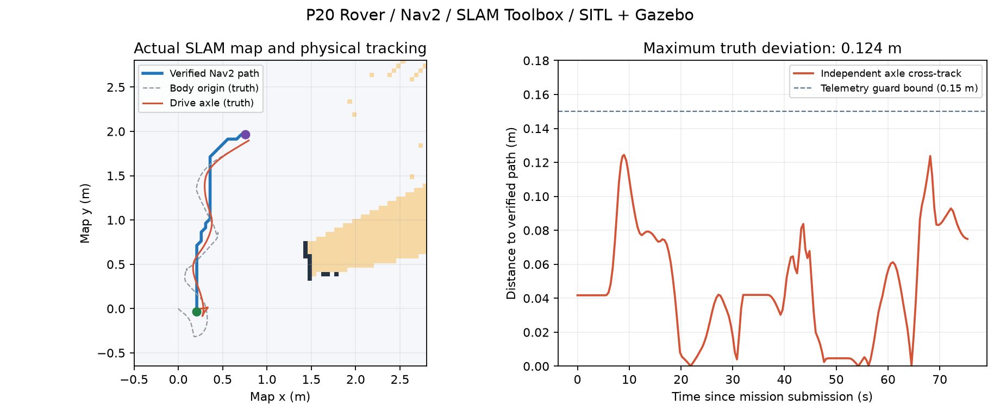

# P20：Rover 路径跟踪验收

日期：2026-10-19。状态：**PASS（限定前驱 Rover / 二维在线地图 / 本机物理仿真）**。

范围、接口和复现命令见 [路径跟踪说明](../rover_path_following.md)。基础车辆控制层、冻结合同及真实硬件范围没有扩大。

## 已实现

- 显式 NavigationConfig、在线路径准入和单次消费；默认不注册运动任务、不打开 SEND。
- 正式 `follow_path` Mission：GUIDED → Arm → FollowPath → 观察到停车 → Disarm。
- 纯 Guidance、单调局部进度、按弯折缩短前视、角速度反馈；Action 只读状态并输出 Typed Effect。
- 前轴中心参考点、原始地图 SHA 内容复核、有限 map←odom 绑定、当前地图整段重新校验和变更失效。
- 原 writer 的附加拒绝检查，排队旧运动不能绕过新地图失效；地图丢失仍可经原 StopMotion 屏障停车。
- 公开 CLI 启动/取消/恢复、独立 Gazebo truth、真实 Nav2 Costmap、源码哈希及所属进程/端口清理证据。

## 最终验收

运行：`./scripts/test_navigation_v1.sh "$PWD/artifacts/simulation/navigation-final-20261019"`，复用显式指定的本机 SITL 二进制目录。

**223 项单元测试通过，0 失败/错误/跳过**，其中新增路径跟踪测试 17 项。全量耗时 16.707 s；默认 `python -m app.main status` 仍为 unwired / SEND false。编译与 `git diff --check` 通过。

实际 ROS 2 Jazzy / SLAM Toolbox / Nav2 **1.3.13** / Rover SITL / Gazebo 运行结果：

| 场景 | 结果 | 独立物理证据 |
| --- | --- | --- |
| 完整跟踪 | PASS | 真实 Nav2 **2.316 m / 44 点**，相对直线绕行 **0.319 m**；主动轮轴真值最大横向偏离 **0.124 m**，目标误差 **0.075 m**；最终停车并 Disarm，双 SEND 关闭。 |
| 运动中取消 | PASS | `CANCELLED`，**5.806 s** 内停车确认；退出后显式 safe_recovery 确认 Disarm。 |
| 地图源丢失 | PASS | `navigation_map_unavailable`，自动失败并在 **5.702 s** 内停车确认；地图无效时原停车/恢复链仍可用。 |
| 路径文件修改 | PASS | `navigation_plan_file_changed`，拒绝继续运动，**5.704 s** 内停车确认；不自动加载修改后的文件。 |
| Action 超时 | PASS | 显式 10 s 有限配置，准确失败原因为 `navigation_deadline_exceeded`；从源状态 cut 推导实际截止，之后 **2.810 s** 内完成停车确认。 |

五项最终停车速度均 ≤0.017 m/s，低于原 0.10 m/s 阈值；没有放宽原 8 s 停车截止。独立真值按车体原点核对柱体距离与房间内壁距离：完整跟踪最小柱体距离 **0.969 m**、最小内壁距离 **2.236 m**，均超过该模型的 0.51 m 车体包围半径。

30 次地图/对齐变更重新校验发生在完整任务中。五次实际 Nav2 的原生 Costmap 一致性与规划进程组释放全部通过；五个自有物理场景的进程组均清空、TCP/JSON 端口全部释放。没有打开实机设备或全局杀进程。

图中灰色虚线是车体原点，红线是实际跟踪的主动轮轴。初始转向会移动车体原点；两者不能混用。右图虚线为遥测检查阈值，红线为独立真值测量，二者来源不同。

## 证据与基线

- 本机完整报告：`artifacts/simulation/navigation-final-20261019/summary.json`；各项原始状态、Effect、轨迹、完整 final-task、Nav2 输入/响应和 manifest 位于同目录的场景子目录。
- 已提交的[证据快照](evidence/phase-20.json)包含五项 summary、manifest、准入帧绑定/路径、Nav2 版本/清理及原始证据 SHA。
- 实测工作树的父提交为 `ce0a82a`，测试时工作树含本阶段改动。五项实测和最终 motion/config/runner 源码树 SHA256 一致：`51d4d1621bb4a026cae43f69e443780598e85b00fd12058d6e81d913059deec6`。不能用父提交单独代表本阶段实现。
- 本轮没有重跑历史全部 29 阶段/21 场景或 Copter 物理任务；公共默认组合由全量单元测试覆盖，本阶段物理验收只针对上述 Rover 场景。

## 保留的开发失败

- 初始目标的 0.85 m 余量碰到真实地图中的未知栅格，正确拒绝。没有补画空闲区域或替换实际 SLAM 地图。
- `path-tracking-43021b6e`：把车体原点误当转动中心，初始 pivot 造成越界，自动停车。已根据实际主动轮位置改用前轴参考点，并把规划余量提高至 0.95 m。
- `path-tracking-7ef3248b`、`path-tracking-0202930a`：短前视的航向反馈振荡，触发 70 s 截止并停车。修正为较长前视、弯折处独立缩短前视及较低增益；未增加截止或放宽横向阈值。
- 预验收 `path-tracking-8d7c0e72` 已完成一次正常跟踪；最终五场景使用以上统一源码哈希重新运行，不拿中间成功替代最终验收。
- 早期 runner 还修正了预热阶段真值年龄检查、CLI 极小负数的科学计数解析和按模型余量选择可观测目标的问题；原始目录保留，不计入最终 PASS。

## 仍未完成

本阶段只证明上述有限静态场景。自动重规划、动态障碍、任意复杂/长路径、最终 yaw、速度/加速度轨迹、Nav2 Controller/MPPI、其他 Rover 几何、多旋翼/固定翼/VTOL 导航均未验收。P18 轴对齐房间边界缺陷仍开放；SLAM 没有替换遥测定位或融合 GPS/VIO。实车制动、失联物理停车、传感器质量和生产部署仍未完成，失联停车继续保持 `UNCONFIRMED`。
