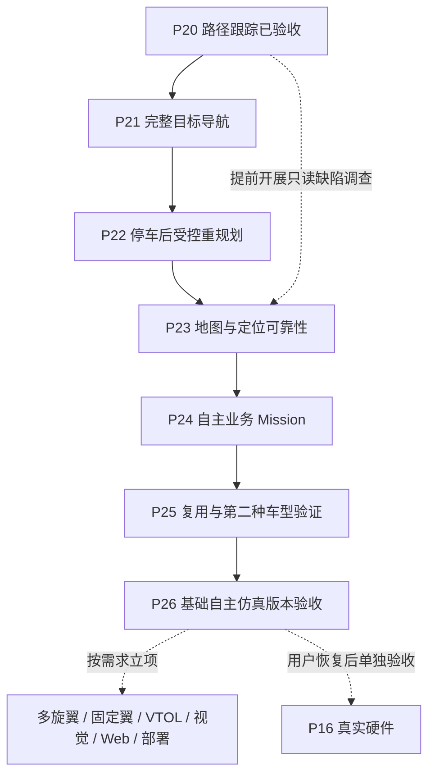

# Vehicle Autonomy Framework：P20 之后的总计划

日期：2026-10-19。状态：**后续工作规划，尚未实施**。

当前实现基线为 `496796c`。P20 的 223 项单元测试、5 项 Rover 导航正常/故障仿真验收已经通过；证据见 [P20 审计](autonomy/phase-20.md)。本文安排后续顺序，不提高现有模块完成度，不代替逐阶段实施计划与验收。

## 1. 总体目标与当前范围

目标是形成可复用的自主车辆程序：操作者提交明确目标，Application 组织状态、规划、Mission 和 Action，经统一授权与 Safety 执行，并能解释成功、失败、取消和停止结果。

当前主线继续使用**当前电脑、本机 ROS 2 / SITL / Gazebo、Rover 仿真**。先完成目标导航和故障收束，再验证配置与车型复用。真实飞控与车辆硬件仍暂缓；历史 **P16 保持暂缓**，后续恢复时沿用该编号。

车辆基础控制层作为已验收基线维护。新功能复用原 Effect、双 SEND、Lease、Safety 和唯一 writer；只有发现具体缺陷或新能力确实需要时才修改底层，并补相应回归。冻结合同如需扩展，要单独审查兼容性，不能因一个业务场景直接改写通用语义。

## 2. 已完成的基础

| 范围 | 已有能力 | 保留边界 |
| --- | --- | --- |
| 基础合同、状态与控制链 | 时间、Frame、World Model、Typed Action/Mission、授权、Safety、唯一 writer | 仿真/受限诊断不等于生产整车验收。 |
| Copter / Rover 基础车辆控制 | 两车运动、停止、取消、deadman 和故障仿真基线 | 实机物理停止与失联行为未验收。 |
| P9–P15 | Application、在线状态链、Environment、基本 Action/Mission、仿真对象和业务示例 | 业务示例仍有限定输入与执行范围。 |
| P17 | 记录图像、CPU 推理、虚拟标定下的感知替换 | 真实采集、空间标定及现场目标质量未完成。 |
| P18 | ROS 2 / SLAM Toolbox 二维建图、地图资源与导出重载 | 轴对齐房间边界缺陷仍开放，SLAM 未替换遥测定位。 |
| P19 | Nav2 只读几何路径规划和独立校验 | 输出本身没有车辆执行权限。 |
| P20 | 显式在线路径消费、前轴参考点跟踪、地图失效停车 | 仅指定前驱 Rover、有限静态路径；需手动组织规划和任务启动。 |

历史迁移阶段、基础控制仿真 Phase 0–8 和后续 P 阶段是不同计数体系，不重新编号。[模块进度](v1_progress.md)继续记录实际证据和缺口。

## 3. 后续主线总表

P21–P26 为本路线图提出的后续阶段。先完成前置验收，再扩大功能或支持声明。

| 顺序 | 阶段 | 主要结果 | 前置条件 | 完成门槛 |
| --- | --- | --- | --- | --- |
| 1 | **P21：完整目标导航 Mission** | 从命名目标组织规划、路径准入、执行和结果；减少手工坐标/文件操作 | P20 | 公开用例完成目标导航及生命周期验收；规划不阻塞车辆周期。 |
| 2 | **P22：停车后受控重规划** | 路径失效后确认停车，在任务授权范围内有限重规划和重新准入 | P21 | 可恢复变化能继续；无路、超预算和不可恢复故障能正确结束。 |
| 3 | **P23：地图与定位可靠性** | 明确地图适用范围、持久化坐标和定位来源，处理现有建图缺陷 | P18–P22 的输入/失效语义 | 支持场景有独立几何与定位证据；不可靠地图或定位被拒绝。 |
| 4 | **P24：自主业务 Mission 整合** | 让巡检、命名路线和对象任务使用已验收导航能力 | P21、P22；所用地图须满足 P23 对应门槛 | 业务目标、导航结果、对象有效期和安全退出构成完整闭环。 |
| 5 | **P25：复用与配置验证** | 提取车型导航模型和可替换装配，验证第二种 Rover 几何 | P21–P24 的接口和实际使用经验 | 第二种仿真模型无需改通用 Core，原模型仍通过回归。 |
| 6 | **P26：基础自主仿真版本验收** | 固定范围、统一启动/报告、重复任务和长运行验证，形成可交付版本 | P21–P25 | 该版本声明的单元、集成、物理、故障、资源清理与复现门槛全部通过。 |

P23 的缺陷复现和只读调查可以提前。P21/P22 的验收先限定在已有可靠场景；地图缺陷未解决或未形成可靠拒绝条件时，不扩大场景支持范围。

## 4. P21：完整目标导航 Mission

### 4.1 统一目标语义

- 定义导航目标的地点名称、Frame、Environment/地图依赖、位置容差和有限任务期限。
- 明确目标描述车体原点、主动轮轴或其他已注册参考点；不能把现有 HOME/A 点静默解释成另一种参考点。
- 从 World Model 获取当前位置，显式处理 odom/map 转换和帧代际。先支持命名地点；需要直接坐标时再增加受验证的用例参数。
- 预留车型导航模型的注入位置，避免把 P20 的 0.25 m 偏移继续写入通用目标或 Core。

### 4.2 Application 组织完整流程

```text
请求导航到命名地点
        ↓
目标、能力、地图、定位与授权预检
        ↓
独立进程规划 → 路径校验与准入
        ↓
复用路径跟踪 Action 和原安全执行链
        ↓
观察到停车 → 完成 / 失败 / 取消
```

规划进程有超时、取消和所属资源清理；结果携带请求身份及输入依赖。规划期间车辆周期继续运行，晚到结果不能恢复已取消任务。第一版仍保持路径失效就停车，不做自动重规划。

### 4.3 验收范围

覆盖不同起终点、起始朝向、折线、可通行走廊、不可达目标、规划失败/超时、规划中取消、执行中取消、连续请求和旧结果隔离。路径必须落在已观测安全区域，并满足既有速度、碰撞和期限约束；超限任务应拒绝或失败，不能为通过测试直接放宽限制。

**交付：** 目标用例/参数、Application 编排、可复用导航 Mission、场景与故障测试、阶段报告和提交。

## 5. P22：停车后受控重规划

第一版采用以下状态序列：

```text
路径被当前地图判为失效
        ↓
停止旧运动、隔离旧排队请求
        ↓
确认物理仿真停车
        ↓
获取有效地图/定位 → 有限重规划 → 独立校验
        ↓
重新准入、核验授权 → 新的执行尝试
```

- 实施前冻结可恢复原因、最大次数、重试间隔、总期限和取消行为；重试不无限续期任务或租约。
- 只有操作者显式授权的任务策略才可自动重规划；新结果仍需完整校验和当前授权，不能把旧计划的许可复制过去。
- 地图源丢失、定位无效、时钟/Frame epoch 改变、断链、Safety 拒绝和操作者取消，默认结束或等待明确恢复，不通过重规划绕过。
- 使用独立的当前地图快照来源；P19 现有在线入口要求 READY 且双 SEND 关闭，不能简单删除该限制来支持任务中的重规划。
- 新增物体使原路失效、有替代路、完全封路、反复变化、预算耗尽和重规划中取消均须验收。

**交付：** 重规划策略、状态机、旧请求隔离、故障报告。此阶段不声称连续动态避障，也不直接引入 ROS 命令发送桥。

## 6. P23：地图与定位可靠性

按三个子阶段推进，均继续在仿真中验证：

1. **P23A 地图质量与已知缺陷：** 复现轴对齐墙面缺失，查明上游/配置/适配原因；处理后验证轴对齐与旋转场景。不能补画障碍、填空闲格或只旋转验收场景来宣称缺陷已解决。暂不能修复时须记录不支持条件、可实现的准入检查及其检测边界。
2. **P23B 地图持久化与环境坐标：** 在已有导出/重载基础上，规定地图身份、原点、命名点、HOME、地图版本与定位 epoch 的绑定。重载、重启、原点变化不能把旧命名点误投到新环境。
3. **P23C 定位来源与质量：** 审查 ROS 2 SLAM/定位输入作为可选定位来源的适配，处理时间、TF、重定位跳变、丢失和恢复。先明确单一活动来源及切换规则；需要融合时另定模型与验收，不能直接平均 GPS 和 SLAM 位姿。

**完成门槛：** 独立场景真值核对地图和定位；重载后目标含义正确，定位异常停止执行。只声明实际验收过的场景，未知空间继续阻挡。

## 7. P24：自主业务 Mission 整合

复用已经存在的基本 Mission、仿真对象和记录视觉能力：

- 命名路线：A → B → HOME，经地图规划与导航执行。
- 巡检：到检查点 → 停稳 → 获取规定观测 → 保存业务结果。
- 对象任务：读取有效对象 → 选择目标 → 解析可达接近位置 → 导航 → 执行业务 Action。
- 现有 `object_inspection` / `cuadc_demo` 按需采用新导航能力，保留已验收行为作为回归基线；不因名称相同就强行替换两车实现。

对象丢失、观测过期、目标移动、接近位置未知或不可达均有明确结果。先使用现有仿真/记录输入；业务层仍不能调用车辆端口。真实载荷和现场识别不由本阶段自动获得支持。

## 8. P25：复用与配置验证

把已经出现的差异整理为有类型、可校验、可记录版本的装配参数：

- Vehicle Navigation Model：参考点变换、车体包络、运动约束、允许 Effect 与能力。
- 任务、规划、传感器、地图、定位和 Deployment 的显式选择与依赖预检。
- 两种 Rover 仿真几何之间的替换；第二种模型须有真实动力学场景及独立真值，不只验证接口可以实例化。
- 固定配置版本、参数来源、失败原因、运行日志和回放证据，使问题可复现。

**完成门槛：** 两种模型各自通过所声明的正常/故障场景，共享 Core 不增加具体车型分支，原前驱模型不回退。规划后端、定位源和传感器只有实际替换验收后才计入支持列表。

## 9. P26：基础自主仿真版本验收

建议版本范围命名为 **Rover Autonomy Simulation V1**，在立项时冻结其功能清单。预期包含命名目标导航、有限重规划、受支持地图/定位、至少一种业务组合及车型配置复用。

- 整合必要的车辆基础回归、Application、地图、规划、跟踪和业务正常/故障验收；变更影响范围外的历史能力按明确门槛执行兼容回归。
- 重复任务和有界长运行验证，检查周期、队列、内存、句柄、进程/端口、ID/重试预算与日志体积。
- 检查取消、关闭、断链、重启和重连默认只读；停止未知仍报告 `UNCONFIRMED`。
- 提供明确依赖、配置、启动/停止命令、独立物理证据、源码版本及完成审计。
- mandatory gates 不允许通过跳过、伪造输入或放宽门槛取得 PASS。

版本 PASS 只代表冻结的 Rover 仿真范围，不代表整个框架所有机型、部署和真实硬件均完成。

## 10. 条件性扩展安排

以下工作没有全部纳入 P21–P26 的必做串行路径；按实际产品需求单独立项。不会把尚未开发的可选能力算成已完成。

| 扩展方向 | 建议启动条件 | 第一阶段结果 | 主要验收边界 |
| --- | --- | --- | --- |
| 多旋翼地图导航 | 目标/导航接口稳定，选定飞行场景 | 在 Copter 仿真中验证高度、起降和空间约束下的目标任务 | 二维地面路径不能直接充当飞行安全轨迹；三维障碍和飞行动力学另验收。 |
| 固定翼 / VTOL | 明确机型需求、动力学模型与执行器；先制定阶段计划 | 车辆插件、模式与状态适配，再逐步验证任务 | 最小转弯半径、持续飞行、起降、VTOL 转换及失联处置不能沿用 Rover 停车语义。 |
| 在线视觉 / 三维感知 | 业务确实依赖相应输入，已有可验收采集源 | 先接仿真相机/深度/点云与标定，再替换检测或建图实现 | 记录图像验证不等于在线采集、真实标定、SLAM/VIO 融合或现场精度。 |
| Web / Gateway | Application 用例及控制权规则稳定 | 先做只读状态、地图、任务和日志显示，再评审任务控制 | UI/远程服务只调用用例；不能获得独立车辆 writer 或绕过本地 Safety。 |
| 服务器 / 板载部署 | 明确目标环境并恢复该部署需求 | 配置、进程管理、日志、升级与恢复的可复现装配 | 当前电脑通过不代表服务器或 RKNN 支持；网络失联与控制源冲突需单独验证。 |
| **P16 真实硬件** | 用户明确恢复、设备/接口/时间来源已知、相关软件验收通过 | 只读设备状态与时间/Frame 校验，再逐步受控命令和现场验收 | 机架/传感器/执行器校准、真实制动和失联行为；未确认停止不能记成功。 |
| Intent / LLM / Agent | 有明确业务输入、提案类型、校验规则和评测集 | 生成受验证任务提案，复用 Application/Mission | 模型不能直接生成可发送车辆命令；不作为当前导航主线的依赖。 |

ROS 2 继续作为可选算法/设备适配生态使用；普通框架默认入口无需启动 ROS。不同车型需要的规划器和传感器可以不同，但状态与执行边界保持一致。

## 11. 顺序、记录与当前下一项



按阶段门槛安排工作，不在未知工作量下承诺固定日期。每阶段实施前细化范围、依赖、参数和必过场景；结束后记录实际源码、测试、失败过程、剩余问题并提交。计划、实现完成和验收 PASS 分开记录。

**当前下一项：P21。** 先冻结导航目标/参考点语义和 Application 编排，再实现命名目标到规划、执行与结果的完整流程；P23A 的问题复现可以提前，不影响 P21 保持限定场景。
